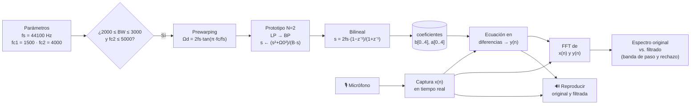

# butterworth-audio-processor
# Laboratorio 1 — Filtro Butterworth Pasabandas (Transformación Bilineal)

**Curso:** Procesamiento de Señales e Imágenes — Ingeniería de Sistemas
**Corte:** 3
**Lenguaje:** Python

---

## 1. Enunciado

Diseñar e implementar un **filtro Butterworth pasabandas de orden 2** discretizado con **transformación Bilineal**, que cumpla:

| Requisito | Valor |
|---|---|
| Tipo de filtro | Butterworth pasabandas (IIR) |
| Orden del prototipo | N = 2 |
| Discretización | Transformación Bilineal con *prewarping* |
| Ancho de banda | 2000 Hz ≤ BW ≤ 3000 Hz |
| Frecuencias de corte | fc1 < fc2 ≤ 5000 Hz |
| Frecuencia de muestreo | fs = 44100 Hz (sugerida) |
| Entrada | Voz capturada en tiempo real (micrófono activado) |
| Salidas | Espectro de la señal original vs. filtrada (banda de paso y de rechazo visibles) y reproducción de ambas señales |

**Parámetros elegidos:** fc1 = 1500 Hz, fc2 = 4000 Hz → BW = 2500 Hz ✔

---

## 2. ¿Cómo funciona?



---

## 3. Fundamento matemático

### 3.1 Prototipo Butterworth normalizado (N = 2)

$$H(s) = \frac{1}{s^2 + \sqrt{2}\,s + 1}$$

### 3.2 Prewarping

$$\Omega_{d1} = \frac{2}{T}\tan\left(\frac{\pi f_{c1}}{f_s}\right), \qquad \Omega_{d2} = \frac{2}{T}\tan\left(\frac{\pi f_{c2}}{f_s}\right)$$

$$\Omega_0 = \sqrt{\Omega_{d1}\,\Omega_{d2}}, \qquad B = \Omega_{d2} - \Omega_{d1}, \qquad T = \frac{1}{f_s}$$

### 3.3 Transformación pasabajas → pasabandas

$$s \leftarrow \frac{s^2 + \Omega_0^2}{B\,s}$$

$$H_{BP}(s) = \frac{B^2 s^2}{s^4 + \sqrt{2}B\,s^3 + (2\Omega_0^2 + B^2)\,s^2 + \sqrt{2}B\,\Omega_0^2\,s + \Omega_0^4}$$

El filtro digital resultante es de **orden 4** (orden 2 del prototipo × 2 por la transformación a pasabandas).

### 3.4 Transformación Bilineal

$$s = K\,\frac{1 - z^{-1}}{1 + z^{-1}}, \qquad K = \frac{2}{T} = 2 f_s$$

Multiplicando numerador y denominador por $(1 + z^{-1})^4$:

- **Numerador:** $B^2K^2(1 - z^{-1})^2(1 + z^{-1})^2 = B^2K^2\,(1 - 2z^{-2} + z^{-4})$
  → $b = B^2K^2\,[1,\ 0,\ -2,\ 0,\ 1]$
- **Denominador:** $K^4u^4 + \sqrt{2}BK^3u^3v + (2\Omega_0^2 + B^2)K^2u^2v^2 + \sqrt{2}B\Omega_0^2K\,uv^3 + \Omega_0^4v^4$
  con $u = 1 - z^{-1}$, $v = 1 + z^{-1}$ → $a = [a_0, a_1, a_2, a_3, a_4]$

### 3.5 Ecuación en diferencias

$$y(n) = \frac{1}{a_0}\left[\sum_{k=0}^{4} b_k\,x(n-k) - \sum_{k=1}^{4} a_k\,y(n-k)\right]$$

### 3.6 Espectro

$$\|Y(\Omega)\| = \|X(\Omega)\|\,\|H(\Omega)\|$$

---

## 4. Estructura del repositorio

```
lab1_butterworth_pasabandas/
├── README.md
├── requirements.txt
├── main.py
├── config/
│   └── parametros.py
├── src/
│   ├── diseno/          # prototipo, prewarping, transformación BP, bilineal
│   ├── filtrado/        # ecuación en diferencias (implementación propia)
│   ├── audio/           # captura y reproducción
│   ├── analisis/        # FFT y respuesta en frecuencia
│   ├── visualizacion/   # gráficas
│   └── interfaz/        # aplicación de usuario
├── tests/               # validación contra scipy.signal.butter
├── notebooks/           # desarrollo matemático paso a paso
├── grabaciones/
│   ├── originales/
│   └── filtradas/
├── resultados/
│   ├── graficas/
│   └── coeficientes/
└── informe/
    ├── evidencias/
    ├── calculos_manuales/
    └── referencias.md
```

---

## 5. Instalación y ejecución

```bash
git clone <url-del-repo>
cd lab1_butterworth_pasabandas
python -m venv venv
source venv/bin/activate        # Windows: venv\Scripts\activate
pip install -r requirements.txt
python main.py
```

**requirements.txt**

```
numpy
scipy
matplotlib
sounddevice
soundfile
```

### Verificación del diseño

```bash
python -m pytest tests/
```

Compara los coeficientes `b`, `a` calculados manualmente con `scipy.signal.butter(2, [fc1, fc2], btype='bandpass', fs=44100)`. `scipy` se usa **solo** como verificación; el diseño y el filtrado son implementación propia.

---

## 6. Resultados esperados

- [ ] Respuesta en frecuencia |H(e^jΩ)| con −3 dB en fc1 y fc2
- [ ] Espectro de la voz original con contenido en todo el rango audible
- [ ] Espectro de la voz filtrada con contenido concentrado entre fc1 y fc2
- [ ] Atenuación visible en las bandas de rechazo (< fc1 y > fc2)
- [ ] Reproducción de ambas señales con diferencia audible

---

## 7. Integrantes

| Nombre | Código |
Juan David Navarro Bermúdez - 160005245
Daniel Santiago Santos Granados - 160005236
