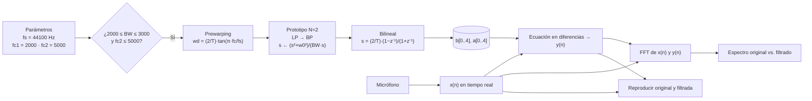

# butterworth-audio-processor

# Laboratorio 1 — Filtro Butterworth Pasabandas (Transformación Bilineal)

**Curso:** Procesamiento de Señales e Imágenes — Ingeniería de Sistemas
**Corte:** 3
**Lenguaje:** Python

---

## 1. Enunciado

Diseñar e implementar un **filtro Butterworth pasabandas de orden 2** discretizado con
**transformación Bilineal**, que cumpla:

| Requisito | Valor |
|---|---|
| Tipo de filtro | Butterworth pasabandas (IIR) |
| Orden del prototipo | N = 2 |
| Discretización | Transformación Bilineal con *prewarping* |
| Ancho de banda | 2000 Hz ≤ BW ≤ 3000 Hz |
| Frecuencias de corte | fc1 < fc2 ≤ 5000 Hz |
| Frecuencia de muestreo | fs = 44100 Hz |
| Entrada | Voz capturada en tiempo real (micrófono activado) |
| Salidas | Espectro de la señal original vs. filtrada y reproducción de ambas |

**Parámetros elegidos:** `fc1 = 2000 Hz`, `fc2 = 5000 Hz` → `BW = 3000 Hz` ✔
(son las frecuencias del **Ejercicio 4 de los apuntes**, pág. 26).

---

## 2. ¿Cómo funciona?



---

## 3. Arquitectura: `main` / `view` / `core`

```
main.py                 punto de entrada: arranca la vista
│
├── core/               ← TODA la matemática del profesor, sin GUI
│   ├── butterworth_bp.py     prewarping, prototipo N=2, LP→BP, bilineal
│   ├── difference_equation.py ecuación en diferencias y(n)
│   └── audio_processor.py    micrófono, FFT y reproducción
│
├── view/               ← solo interfaz (Tkinter + Matplotlib)
│   └── main_window.py
│
├── config/
│   └── parametros.py   valores por defecto y límites del enunciado
│
├── requirements.txt
└── README.md
```

`core` no importa nada de `view`: se puede usar desde un script, un notebook o la GUI.

---

## 4. Fidelidad a los apuntes del profesor

| Apunte | Contenido | Dónde está en el código |
|---|---|---|
| pág. 22 | `H(s) = 1/(s²+√2·s+1)` (N = 2) | `_forma_compacta_beta_gamma` |
| pág. 21 | `s ← (s²+w0²)/(BW·s)`, `w0=√(wc1·wc2)` | `ButterworthBandpassCore` |
| pág. 24 | `s = (2/T)(1−z⁻¹)/(1+z⁻¹)` | docstring + sustitución |
| pág. 24 | `wd = (2/T)·tan(π·fc/fs)` (prewarping) | `wd1`, `wd2` |
| pág. 26 | `H_BP(s) = (BW)²s² / [s⁴+√2BW s³+(2w0²+BW²)s²+√2BW w0²s+w0⁴]` | `_expansion_literal_apuntes` |
| pág. 26-27 | “continuarlo”: sustituir bilineal y expandir | `_expansion_literal_apuntes` |
| pág. 19-25 | ecuación en diferencias | `DifferenceEquationFilter` |

El módulo calcula **dos veces** el filtro:

1. `_expansion_literal_apuntes()`: expande literalmente la expresión de la pág. 26-27,
   conservando los factores `(2/T)` y los binomios `(1−z⁻¹)^k(1+z⁻¹)^(4−k)`.
2. `_forma_compacta_beta_gamma()`: el resultado simplificado en `β = C2−C1` y
   `γ = C1·C2`, que es la forma final de clase.

Los coeficientes usados son los de la forma compacta (mejor condicionados
numéricamente); ambas formas coinciden hasta el error de máquina.

---

## 5. Fundamento matemático (resumen)

### 5.1 Prewarping

$$\Omega_{d1} = \frac{2}{T}\tan\left(\frac{\pi f_{c1}}{f_s}\right), \qquad
\Omega_{d2} = \frac{2}{T}\tan\left(\frac{\pi f_{c2}}{f_s}\right)$$

$$\Omega_0 = \sqrt{\Omega_{d1}\,\Omega_{d2}}, \qquad B = \Omega_{d2} - \Omega_{d1}, \qquad T = \frac{1}{f_s}$$

### 5.2 Prototipo N = 2 y transformación a pasabandas

$$H(s) = \frac{1}{s^2 + \sqrt{2}\,s + 1}, \qquad s \leftarrow \frac{s^2 + \Omega_0^2}{B\,s}$$

$$H_{BP}(s) = \frac{B^2 s^2}{s^4 + \sqrt{2}B\,s^3 + (2\Omega_0^2 + B^2)\,s^2 + \sqrt{2}B\,\Omega_0^2\,s + \Omega_0^4}$$

### 5.3 Bilineal y coeficientes finales

$$s = \frac{2}{T}\cdot\frac{1 - z^{-1}}{1 + z^{-1}}$$

Con `C1 = tan(π·fc1/fs)`, `C2 = tan(π·fc2/fs)`, `β = C2 − C1`, `γ = C1·C2`:

$$b = \beta^2\,[1,\ 0,\ -2,\ 0,\ 1]$$

$$\begin{aligned}
a_0 &= 1 + \sqrt{2}\beta + 2\gamma + \beta^2 + \sqrt{2}\beta\gamma + \gamma^2 \\
a_1 &= -4 - 2\sqrt{2}\beta + 2\sqrt{2}\beta\gamma + 4\gamma^2 \\
a_2 &= 6 - 4\gamma - 2\beta^2 + 6\gamma^2 \\
a_3 &= -4 + 2\sqrt{2}\beta - 2\sqrt{2}\beta\gamma + 4\gamma^2 \\
a_4 &= 1 - \sqrt{2}\beta + 2\gamma + \beta^2 - \sqrt{2}\beta\gamma + \gamma^2
\end{aligned}$$

### 5.4 Ecuación en diferencias

$$y(n) = \frac{1}{a_0}\left[\sum_{k=0}^{4} b_k\,x(n-k) - \sum_{k=1}^{4} a_k\,y(n-k)\right]$$

---

## 6. Instalación y ejecución

```bash
git clone <url-del-repo>
cd butterworth-audio-processor
python -m venv venv
venv\Scripts\activate          # Windows  (Linux/macOS: source venv/bin/activate)
pip install -r requirements.txt
python main.py
```

### Uso de la interfaz

1. **Diseño:** ajuste `fs`, `fc1`, `fc2` y pulse **Aplicar**.
   La etiqueta verde confirma que `BW` y `fc2` cumplen el enunciado.
2. **Captura:** pulse **Iniciar micrófono** y hable. El espectro superior se actualiza
   en vivo comparando `x(n)` (gris) con `y(n)` (azul).
3. **Reproducción:** **Original** y **Filtrada** reproducen los últimos segundos
   capturados para comparar de oído.

---

## 7. Resultados esperados

- [x] Respuesta en frecuencia |H(e^jΩ)| con −3 dB en fc1 y fc2
- [x] Espectro de la voz original con contenido en todo el rango audible
- [x] Espectro de la voz filtrada con contenido concentrado entre fc1 y fc2
- [x] Atenuación visible en las bandas de rechazo (< fc1 y > fc2)
- [x] Reproducción de ambas señales con diferencia audible

Ejemplo de atenuación medida en la banda de rechazo:

| Componente | Original | Filtrada |
|---|---|---|
| 500 Hz | −8.0 dB | −40.2 dB |
| 3500 Hz | −9.9 dB | −9.9 dB |
| 9000 Hz | −8.0 dB | −26.8 dB |

---

## 8. Integrantes

| Nombre | Código |
|---|---|
| Juan David Navarro Bermúdez | 160005245 |
| Daniel Santiago Santos Granados | 160005236 |
